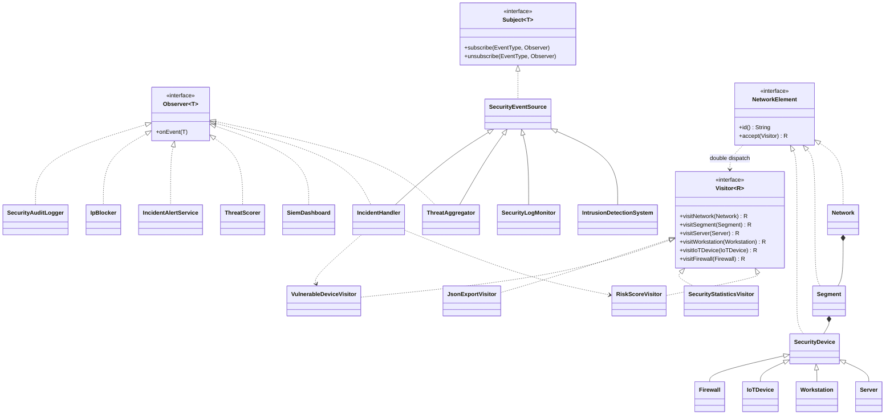

# Assignment 6 — Security Operations Center

Java 17 simulation of a Security Operations Center using
Observer and Visitor design patterns.

No external production libraries. JUnit 5 is used for testing.

## Running the project

Run tests:

    mvn clean test

Compile:

    mvn -q -DskipTests compile

Run:

    java -cp target/classes app.Main 3

The optional argument specifies the number of producer threads.
The minimum is 3.

## Observer Pattern

Two independent event sources:

- IntrusionDetectionSystem
- SecurityLogMonitor

Five main listeners:

- SiemDashboard
- ThreatScorer
- IncidentAlertService
- IpBlocker
- SecurityAuditLogger

ThreatAggregator is both an Observer and a Subject.

### Push vs Pull

The project uses the Push model.

Each event contains the type, segment ID, source IP,
message, severity, and timestamp.

Listeners receive all necessary information in the event
without requesting additional data from the source.

SecurityEvent is an immutable Java record.

### Thread Safety

ConcurrentHashMap manages subscriptions by event type.
CopyOnWriteArrayList allows concurrent subscriptions and
unsubscriptions without locking the entire subject.

Listeners can subscribe or unsubscribe during callbacks.

An already-running notification may still reach a listener
that has just unsubscribed because notification uses a
snapshot of subscribers.

### Event aggregation

Events with severity 8 or higher are counted per segment.

Every pair of high-severity events in a segment generates
a THREAT_CLUSTER_DETECTED event.

This demonstrates chained Observers.

## Visitor Pattern

The Composite network structure contains:

Network
Segment
Server
Workstation
IoTDevice
Firewall

The Visitor interface supports generic return values.

Four visitors:

1. RiskScoreVisitor — numeric risk calculation.
2. SecurityStatisticsVisitor — cumulative network statistics.
3. VulnerableDeviceVisitor — filtering devices.
4. JsonExportVisitor — nested JSON export.

### Double Dispatch

Every network element implements accept(Visitor<R>).

For example:

    server.accept(visitor);

This invokes:

    visitor.visitServer(server);

The element determines which overloaded visitor method
runs, without instanceof checks.

### Traversal decision

Visitors control traversal.

Network delegates to its segments, and visitors then
process devices within each segment.

Elements only store data and provide accept methods.

A new SecurityStatisticsVisitor is created for every
independent traversal because it accumulates state.

### Risk calculation

Risk points per device:

    criticality * 5 + vulnerabilities * 10

Example:

Office:
- Server: 5*5 + 2*10 = 45
- Workstation: 3*5 + 1*10 = 25
- IoT: 2*5 + 3*10 = 40

Office total = 110

Data center:
- Server: 5*5 + 4*10 = 65
- Firewall: 4*5 + 0*10 = 20

Data center total = 85

Whole network total = 195

The values represent risk points, not percentages.

VulnerableDeviceVisitor selects devices with at least
two known vulnerabilities.

## Integration

The integration flow is:

1. IDS or log monitor publishes a security event.
2. ThreatAggregator detects a cluster of dangerous events.
3. IncidentHandler receives THREAT_CLUSTER_DETECTED.
4. IncidentHandler selects the affected Segment.
5. RiskScoreVisitor calculates the segment's risk.
6. VulnerableDeviceVisitor identifies vulnerable devices.
7. IncidentHandler creates a RiskReport.
8. RISK_REPORT_CREATED is published to subscribers.

Only the affected segment is inspected.

## Concurrency

ExecutorService runs three independent producer tasks.

The number of worker threads is configurable.

Shared counters use AtomicInteger or LongAdder.

Shared collections use concurrent collections.

Publication is synchronous. Therefore, once a producer
task finishes, all its nested notifications have finished.

The executor is shut down and awaited before results
are collected.

This guarantees delivery for completed tasks with
successfully executing listeners, but does not implement
crash recovery or retry failing listeners.

## UML Class Diagram

## Tests

24 JUnit 5 tests are provided in:

- VisitorsTest
- ObserverTest
- IntegrationTest

The tests cover:

- Numeric visitor results
- Subtree calculations
- Cumulative statistics
- Device filtering
- JSON export and escaping
- Invalid device properties
- Subscription by event type
- Unsubscribe during callbacks
- Subscribe during callbacks
- Duplicate subscriptions
- Observer chaining
- Threat aggregation
- Integration events
- Segment-specific reports
- Concurrent event delivery

The stress test publishes:

    4 producer threads * 1000 events = 4000 events

Expected received event count: exactly 4000.

## Visitor Trade-off Proof

The assignment requires two separate Git commits.

### Commit A — New Visitor

Introduce JsonExportVisitor without modifying element classes.

Files changed:

- visitor/JsonExportVisitor.java
- visitor/VisitorsTest.java

Adding a visitor is relatively inexpensive because the
existing element hierarchy remains unchanged.

### Commit B — New Element

Introduce the Firewall element after the original
three leaf types are implemented.

Files changed:

- model/Firewall.java
- visitor/Visitor.java
- visitor/RiskScoreVisitor.java
- visitor/SecurityStatisticsVisitor.java
- visitor/VulnerableDeviceVisitor.java
- visitor/JsonExportVisitor.java
- app/Main.java
- related tests

Adding a new element is more expensive because every
existing visitor needs a new visit method.

The Visitor pattern is most useful when operations change
frequently but element types remain stable.

Record the actual commit hashes after creating these
two commits.

## Limitations

Security data is simulated.

IpBlocker only stores blocked IPs in memory.
It does not modify firewall settings or network devices.

No real IDS, SIEM, or external security API is connected.
